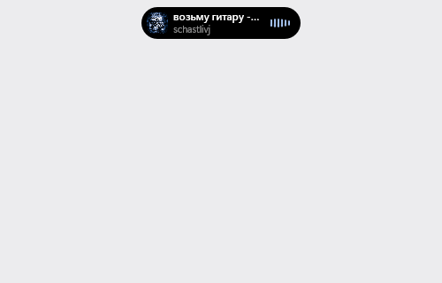
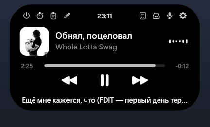
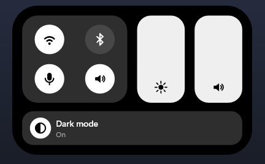
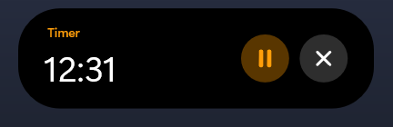
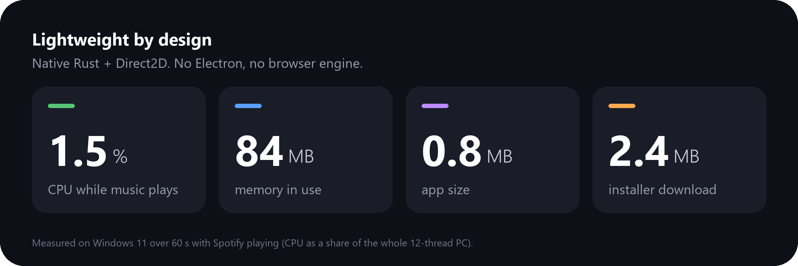

# Dynamic Island for Windows

An Apple-style Dynamic Island for Windows, written in Rust with Direct2D and DirectComposition. It renders only while something animates, so it idles at 0% CPU.

<p align="center"></p>

| Player | Control Center | Timer |
| :---: | :---: | :---: |
|  |  |  |

<p align="center"></p>

- Now playing with album art, waveform, seek bar and synced lyrics (LRCLIB, opt-in: sends the track name to lrclib.net)
- Control Center: scroll down on the island for Wi-Fi, Bluetooth, mic, sound, brightness, volume and dark mode
- Timer, clipboard notices and history, downloads, Focus, Bluetooth headphones, USB plug/unplug
- Volume and brightness pill, mic-in-use dot
- File shelf (drag files in, drag them out later)
- Calculator and unit converter
- Themes with custom colours, size, corners, motion and per-pill settings
- Hides while a game or video is fullscreen; optional start with Windows
- Updates itself from GitHub releases

The exe isn't code-signed, so Windows SmartScreen may warn on first run: click "More info", then "Run anyway".

## Build

```
cargo build --release
```

Run `target/release/dynamic-island.exe`.

Installer: after the build above, compile `installer/setup.iss` with [Inno Setup](https://jrsoftware.org/isinfo.php) (`ISCC installer\setup.iss`) to get `dist/DynamicIsland-Setup.exe`, a per-user installer (no admin) with Start menu and optional desktop shortcuts, an optional Start with Windows switch, and an uninstaller in Settings > Apps.

## License

MIT, see [LICENSE](LICENSE).
