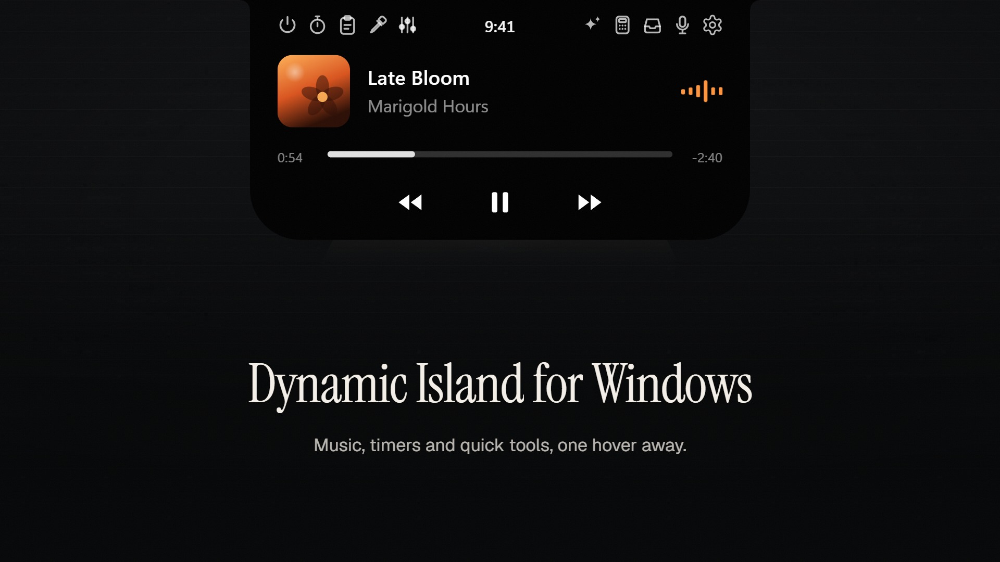

# Dynamic Island for Windows

<p align="center"><a href="docs/demo.mp4"></a></p>

<p>
  <a href="https://github.com/RexXnge/dynamic-island/releases/latest"></a>
  <a href="https://github.com/RexXnge/dynamic-island/releases"></a>
  <a href="LICENSE"></a>
  
</p>

An Apple-style Dynamic Island for Windows, written in Rust with Direct2D and DirectComposition. It renders only while something animates, so it idles at 0% CPU.

<p align="center"><a href="https://github.com/RexXnge/dynamic-island/releases/latest/download/DynamicIsland-Setup.exe"></a></p>

<p align="center">Windows 10 or 11 (64-bit). Installs for your account only: no admin rights, no .NET or other runtimes.</p>

## Island or notch

Float below the top edge, or sit flush against it with square top corners. Switch any time in Settings > Look.

## What it does

- Now playing with album art, waveform, seek bar and synced lyrics (LRCLIB, opt-in: sends the track name to lrclib.net)
- Control Center: scroll down on the island for Wi-Fi, Bluetooth, mic, sound, brightness, volume and dark mode
- Timer, clipboard notices and history, downloads, a moon while Windows Focus is on, Bluetooth headphones, USB plug/unplug
- Volume and brightness pill, mic-in-use dot
- File shelf (drag files in, drag them out later)
- Calculator and unit converter
- Themes with custom colours, size, corners, motion and per-pill settings
- Hides while a game or video is fullscreen; optional start with Windows
- Updates from GitHub releases, installed on their own under an "Installing update" pill (turn off the Updates switch in Settings > Pills to stop checking)

The exe isn't code-signed, so Windows SmartScreen may warn on first run: click "More info", then "Run anyway".

## Why this one

- **Open source:** MIT licensed, every line is here to read.
- **No account, no telemetry:** nothing to sign up for, and it doesn't collect or send usage data.
- **Works offline:** everything runs on your PC. The only network requests are:
  - an update check against GitHub releases (30 s after launch, then every 6 hours; the Updates switch turns it off)
  - the site's icon when you copy an https link to a public site (just `https://<host>/favicon.ico`; never local or plain-http addresses; turn off the Link pill to stop it)
  - synced lyrics from lrclib.net, off by default
- **Native and small:** Rust with Direct2D, no Electron or browser engine, under 1 MB.

## FAQ

**Does it work with games?**
Yes. With "Hide in fullscreen" (on by default), the island hides while a fullscreen game or video covers its display, including borderless fullscreen, and comes back when you leave.

**Does it slow my PC?**
No. It only redraws while something on it moves; otherwise it sleeps. With music playing, the waveform keeps it drawing, which measured 1.5% of a 12-thread CPU and 84 MB of memory.

**How do I uninstall it?**
Settings > Apps > Installed apps > Dynamic Island > Uninstall. Your settings stay in `%APPDATA%\DynamicIsland` in case you reinstall; delete that folder to remove them too.

**Why does Windows warn me when I run the installer?**
The installer isn't code-signed, which costs money every year. Click "More info", then "Run anyway". The source and the build steps are below if you'd rather build it yourself.

## Build

```
cargo build --release
```

Run `target/release/dynamic-island.exe`.

Installer: after the build above, compile `installer/setup.iss` with [Inno Setup](https://jrsoftware.org/isinfo.php) (`ISCC installer\setup.iss`) to get `dist/DynamicIsland-Setup.exe`, a per-user installer (no admin) with Start menu and optional desktop shortcuts, an optional Start with Windows switch, and an uninstaller in Settings > Apps.

## License

MIT, see [LICENSE](LICENSE).
